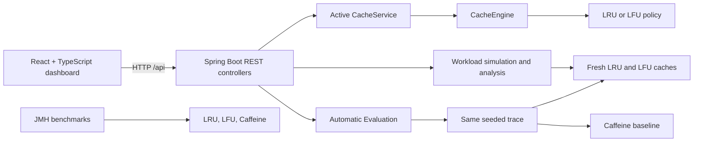

# CachePulse

CachePulse is a cache performance engineering platform for exploring in-memory cache behavior. It implements custom LRU and LFU caches, models per-entry time-to-live (TTL), compares the policies on reproducible synthetic workloads, and includes a Caffeine baseline and opt-in JMH microbenchmarks.

It is an educational and portfolio project. Its healthcare-inspired workload profiles use deterministic synthetic keys; they contain no patient information and do not represent any organization's production traffic.

## Contents

- [Problem and goals](#problem-and-goals)
- [Features](#features)
- [Technology](#technology)
- [Architecture](#architecture)
- [Cache policies and expiration](#cache-policies-and-expiration)
- [Automatic Evaluation](#automatic-evaluation)
- [Dashboard](#dashboard)
- [API overview](#api-overview)
- [Repository layout](#repository-layout)
- [Run locally](#run-locally)
- [Tests and builds](#tests-and-builds)
- [JMH benchmarks](#jmh-benchmarks)
- [Screenshots](#screenshots)
- [Limitations and measurement notes](#limitations-and-measurement-notes)
- [Documentation](#documentation)
- [License](#license)

## Problem and goals

Cache policy performance depends on access patterns. A frequently reused key, a sequential scan, and a mostly uniform key distribution can produce different hit and eviction behavior under the same capacity. CachePulse makes these effects observable in a small, inspectable application.

The project focuses on implementing cache policies, keeping cache metrics consistent, replaying the same generated operation sequence across independent caches, and explaining the limits of timing comparisons. It is not intended as a production cache service or a source of universal policy recommendations.

## Features

- Bounded key/value cache with custom **Least Recently Used (LRU)** and **Least Frequently Used (LFU)** policies.
- Per-entry TTL and hit, miss, eviction, expiration, size, capacity, and policy metrics.
- Live dashboard operations for GET, PUT, remove, clear, policy selection, and cache configuration.
- Workload Lab to compare fresh LRU and LFU caches on the same deterministic synthetic trace and inspect workload characteristics.
- Automatic Evaluation with seeded workload generation, a trace fingerprint, configurable capacity and TTL, LRU/LFU trials, Caffeine baseline, latency percentiles, throughput, and a rule-based recommendation.
- Concurrent GET/PUT stress operation against the active shared cache.
- Opt-in JMH operation and mixed-contention benchmarks.
- Technical documentation and focused backend and frontend tests.

## Technology

| Area | Technology |
| --- | --- |
| Backend | Java 17, Spring Boot 3, Maven |
| Frontend | React 18, TypeScript, Vite |
| Baseline cache | Caffeine 3 |
| Microbenchmarks | JMH 1.37 |
| Backend tests | Spring Boot Test / JUnit |
| Frontend tests | Vitest, Testing Library, jsdom |

## Architecture

The frontend calls the Spring REST API. The backend owns the active cache, policy and metrics; simulation and benchmark services create independent caches for controlled comparisons.



The active cache uses one exclusive lock to protect compound storage, policy, expiry, and counter state. Its entry breakdown in `stats()` is calculated by scanning entries under that lock so the valid and expired counts are exact at the observed clock time.

## Cache policies and expiration

- **LRU:** evicts the least recently accessed entry. Access order is maintained with an access-ordered `LinkedHashMap`.
- **LFU:** evicts the least frequently accessed entry. Frequency metadata is updated as entries are accessed; ties use the implementation's recency ordering.
- **Caffeine baseline:** uses Caffeine's native bounded-cache policy, including W-TinyLFU-oriented admission/eviction behavior. It is a library baseline, not a pure LRU or LFU implementation.

TTL is optional and set per entry. The custom cache uses **lazy expiration**: an expired entry is removed when an operation encounters it; there is no background scan. Caffeine uses its own expiration maintenance. Both benchmark paths receive the same virtual clock and write-TTL configuration, but maintenance semantics are not identical, so expired entries can affect available capacity differently.

## Automatic Evaluation

The `POST /api/benchmarks` flow creates one seeded ordered operation trace, fingerprints it, and replays it against fresh LRU and LFU caches plus a Caffeine baseline. Repeating the same request settings and seed reproduces the trace and cache outcomes. LRU and LFU results summarize configured trials; the Caffeine comparison uses one replay.

Supported synthetic workload patterns:

- `UNIFORM` — keys selected uniformly.
- `ZIPFIAN` — skewed access by key rank.
- `SEQUENTIAL_SCAN` — sequential key scans.
- `BURSTY` — phases of hot-key reuse and cold-key traffic.
- `READ_HEAVY` — skewed reads with a high read ratio.
- `MIXED` — configurable mixture of reads and writes.

The dashboard reports GET hit/miss outcomes, capacity evictions, expiration and other removal causes, and timing measurements separately. Caffeine's `evictions` field represents capacity-based removals only. Its timing includes statistics and removal-listener instrumentation, while LRU/LFU summaries use medians across trials; treat timing as descriptive rather than a direct apples-to-apples ranking. See [API details](docs/API.md) and [benchmark methodology](docs/TECHNICAL_DOCUMENTATION.md#automatic-benchmark-methodology).

## Dashboard

The dashboard provides:

- Live cache metrics, configuration, and entry TTL monitoring.
- Policy selection and side-by-side policy comparison.
- Workload simulation and analysis views.
- Automatic Evaluation controls and outcome/timing comparisons.
- Concurrent stress testing with run-level operation counts and throughput.

## API overview

All application endpoints are under `/api`.

| Endpoint | Purpose |
| --- | --- |
| `GET /api/cache/{key}` | Read an entry and record a hit or miss. |
| `PUT /api/cache/{key}` | Store a value, optionally with `ttlSeconds`. |
| `DELETE /api/cache/{key}` / `DELETE /api/cache` | Remove one entry or clear entries. |
| `GET /api/cache/stats` / `GET /api/metrics` | Read cache metrics. |
| `GET /api/cache/config` / `POST /api/cache/configure` | Read or replace active cache configuration. |
| `POST /api/cache/policy` | Change the active cache policy. |
| `GET /api/cache/workloads` | List Workload Lab profiles. |
| `POST /api/cache/analyze` / `POST /api/cache/simulate` | Run synthetic workload analysis or a sample comparison. |
| `POST /api/cache/stress` | Run concurrent GET/PUT work against the active cache. |
| `POST /api/benchmarks` | Run seeded Automatic Evaluation. |

Request examples, validation bounds, and response fields are documented in [docs/API.md](docs/API.md).

## Repository layout

```text
backend/
  src/main/java/        Spring application, cache engine, policies, API, services
  src/test/java/        Backend tests
  src/jmh/java/         Opt-in JMH benchmarks
  pom.xml               Maven configuration and JMH profile
  mvnw, mvnw.cmd        Maven wrapper scripts
frontend/
  src/                  React dashboard, components, API client, tests
  package.json          Frontend scripts and dependencies
docs/                   API, architecture, technical, testing, and demo guides
```

## Run locally

Prerequisites: JDK 17 or newer, Node.js 20 or newer, and internet access for the initial dependency downloads. The backend Maven wrapper is included.

In PowerShell, start the backend:

```powershell
cd backend
.\mvnw.cmd spring-boot:run
```

In a second terminal, install frontend dependencies and start Vite:

```powershell
cd frontend
npm ci
npm run dev
```

Open <http://localhost:5173>. Vite proxies `/api` requests to the backend at `http://localhost:8080`. `VITE_API_BASE_URL` can point the frontend at another API origin.

Backend settings include `PORT` (default `8080`), `CACHEPULSE_CACHE_CAPACITY` (default `4`, maximum `100000`), and `CACHEPULSE_CACHE_POLICY` (`LRU` or `LFU`). Cache keys are limited to 256 characters, values to 65,536 characters, and JSON request bodies to 512 KiB.

## Tests and builds

Run backend tests and package the application from `backend/`:

```powershell
.\mvnw.cmd test
.\mvnw.cmd package
```

Run frontend tests and create a production build from `frontend/`:

```powershell
npm ci
npm test -- --run
npm run build
```

## JMH benchmarks

The JMH profile is separate from normal application startup. Compile it from `backend/`:

```powershell
.\mvnw.cmd -Pjmh -DskipTests compile
```

Run the benchmark suite:

```powershell
.\mvnw.cmd -Pjmh org.codehaus.mojo:exec-maven-plugin:3.5.0:exec `
  "-Dexec.executable=java" `
  "-Dexec.args=-classpath %classpath org.openjdk.jmh.Main com.cachepulse.benchmark.*"
```

`CacheOperationBenchmark` covers cache operations and configured cache types. `ConcurrentCacheBenchmark` shares cache state among three readers and one writer inserting unique keys. Its read outcomes are schedule-sensitive, so interpret it as a mixed contention benchmark, not a stable read-hit measurement. The configured JMH run uses five one-second warmups, eight one-second measurement iterations, and three forks. Setup/seeding is outside measured operations. Record the JDK, JVM flags, OS, CPU, and exact command with any results. No performance results are claimed in this repository.

## Screenshots

No genuine application screenshots are currently included. To capture them, run the app locally and take screenshots of the main dashboard, Automatic Evaluation results, policy comparison, workload simulation, and concurrent stress results. Save genuine captures under `docs/assets/` and update this section with relative image links. Do not use sample or mock dashboard images as application screenshots.

## Limitations and measurement notes

- Cache state is in process memory; restarting the backend clears it, and multiple backend instances do not share state.
- The API has no authentication or authorization. Keep it on a trusted local network; it is not configured for public production deployment.
- The cache's global lock favors state consistency over parallel throughput. `stats()` scans entries while holding that lock, making the entry breakdown O(cache size).
- Expired custom-cache entries that are never encountered can occupy capacity until an operation touches or replaces them.
- Synthetic workload results are specific to their generated trace. They do not predict a universal best cache policy or production behavior.
- TTL maintenance differs between the custom cache and Caffeine. Caffeine timing also includes stats and removal-listener overhead; its interactive comparison is not equivalent to the JMH configuration.
- JMH and API timing results vary with JVM warmup, machine, and system load. The concurrent JMH group is schedule-sensitive.

## Documentation

- [Architecture](docs/ARCHITECTURE.md)
- [API reference](docs/API.md)
- [Technical documentation](docs/TECHNICAL_DOCUMENTATION.md)
- [Testing guide](docs/TESTING.md)
- [Demo script](docs/DEMO_SCRIPT.md)

## License

No license has been selected for this project. All rights remain with the copyright holder; do not assume the code is licensed for reuse.
